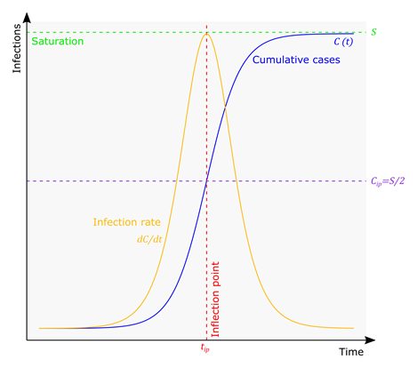

# Logistic growth model

## Background

Just like the [exponential growth model](exponential-growth.md), the logistic growth model is one of the *phenomenological models* for epidemics. In contrast to *mechanistic models* that aim to directly represent mechanisms of infection and spread (e.g., the [SIR model](https://en.wikipedia.org/wiki/Compartmental_models_(epidemiology)#The_SIR_model) and its extensions), phenomenological models of infection waves are statistical models that depict the growth of new infections (e.g., daily or weekly) or cumulative infections over time. A phenomenological model for epidemic modeling has the advantage of being less "data-hungry" and requiring no assumptions about the epidemiological parameters of the infectious disease whose wave is being studied[1][2][3]. 

The logistic growth model was originally developed in demography to describe population growth. It is characterized by distinct phases of growth, resulting in an S-shaped curve of cumulative infections that approaches a saturation limit over time. The growth rate of cumulative infections reaches its maximum at the inflection point and declines thereafter. The logistic curve is symmetric around its inflection point, which marks the transition from an accelerating to a decelerating growth rate. In epidemiology, the model is used to describe the course of an infection wave, as the curve of cumulative infections can exhibit a similar S-shaped pattern to that observed in the SIR model. The infection rate is the first derivative, which corresponds to the number of new infections per unit of time. It reaches its maximum at the inflection point of the logistic curve, after which the number of new infections decreases[1][3][4]. The empirical parameterization of a single logistic growth model requires a [time series](infections-data.md#time-series-data) of [cumulative infections](infections-indicators.md#new-infections-and-cumulative-infections) for the area under study; consequently, comparing growth rates across multiple countries or regions requires [panel data](infections-data.md#panel-data) on cumulative infections.

## Mathematical formulation

The logistic growth function for cumulative infections is formalized as[1][3][4]:

$$C_t = \frac {C_0 \cdot S} {C_0 + (S - C_0) \cdot e^{(-r \cdot S \cdot t)}}$$

where $$C_t$$ is the number of cumulative infections at time point $$t$$, $$t$$ is the time counter, $$C_0$$ is the start value (cumulative infections at time point 0), $$S$$ is the saturation value, and $$r$$ is the intrinsic growth rate.

The first derivative (infection rate) equals:

$$\frac{dC}{dt} = r \cdot C \cdot \Bigl(1-\frac{C_t}{S} \Bigr)$$

The inflection point of the logistic curve is, dependent on the saturation value, equal to

$$ip = \frac{S}{2}$$

at time

$$t_{ip} = \frac{\ln \frac{C_0}{C_t-C_0}}{r \cdot S}$$

where $$ip$$ is the number of cumulative infections at the inflection point, $$t_{ip}$$ is the time point of the inflection point.

The mathematical characteristics are summarized in the following figure:

Source: [3]

## Empirical parametrization

The logistic growth model may be estimated using [Nonlinear Least Squares](https://en.wikipedia.org/wiki/Non-linear_least_squares), given empirical data on cumulative infections (e.g., per day or per week). As an *intrinsically linear model*, the logistic equation may be linearized and estimated using [Ordinary Least Squares](https://en.wikipedia.org/wiki/Ordinary_least_squares), provided that the saturation value is known[3][5][6]:

$$y_t^* = ln (\frac{1}{C_t}-\frac{1}{S}) = ln (\frac{S-C_0}{S \cdot C_0}) - r \cdot S \cdot t $$

$$\hat{y}_t^* = \hat{a} + \hat{b} \cdot t$$

where $$\hat{y}_t^*$$ is the expected value of the transformed dependent variable, and $$a$$ and $$b$$ are the estimates (intercept and slope) of the linear regression model.

The estimates of the logistic function may be calculated from the linear regression estimates:

$$\hat{r} = -\frac{\hat{b}}{S}$$

and

$$\hat{C}_{0} = \frac{S}{1+S \cdot e^{\hat{a}}}$$

This linearization requires that every individual empirical value $$C_t$$ is greater than 0. If values ​​of 0 occur in a time series of infections, all values may be [increased by a constant](data-manipulation.md#handling-zeros-with-log1p-transformation) (e.g., 1), though this will alter the estimate. Values ​​less than 0 (i.e., negative infections) are not possible, provided the input data are correct. Furthermore, the condition $$0 < C_t < S$$ must hold, as otherwise the logarithm cannot be calculated.

Assuming that the saturation value is also to be estimated, the following estimation algorithm (which combines OLS and NLS) is one possible approach[3]:

1. Search for the best $$S$$ value by using [bisection](https://en.wikipedia.org/wiki/Bisection), while minimizing the [sum of squared residuals](https://en.wikipedia.org/wiki/Residual_sum_of_squares) of *B* linearized logistic growth models.
2. Use the best estimate of $$S$$ and use it to transform the $$C_t$$ values into $$y_t^*$$. Fit another OLS model.
3. Calculate the estimates of $$\hat{C}_{0}$$ and $$\hat{r}$$ from the regression coefficients $$a$$ and $$b$$.
4. Use $$\hat{C}_{0}$$ and $$\hat{r}$$ as start values for an NLS estimation. If NLS estimation fails for some reason, use the estimates from the OLS transformation.
5. Compute goodness-of-fit metrics such as the sum of squared residuals, [R-squared](https://en.wikipedia.org/wiki/Coefficient_of_determination), [RMSE](https://en.wikipedia.org/wiki/Root_mean_square_deviation), or [MAPE](https://en.wikipedia.org/wiki/Mean_absolute_percentage_error) for both models and choose the better one.

## Further notes

Since the saturation value - which is, the (mathematically unattainable) final value of an infection wave - can (or must) be estimated, the logistic growth model is also used to forecast the final epidemic size. It should be noted, however, that these estimates can fluctuate significantly with each additional data point, and that the saturation value is particularly problematic to determine when the inflection point of the function has not been reached[7][8][9].

The inflection point of the logistic curve corresponds to the highest infection rate - that is, the peak of infections — after which the infection rate begins to decline (see above). Consequently, determining this inflection point analytically allows for a retrospective analysis of an entire wave of infections, revealing when that wave was "broken". During the COVID-19 pandemic, several studies were published that compared these inflection points at the national[10][11][12] or regional level[3] in order to draw conclusions about the effectiveness of lockdowns. Similarly, there are several studies on COVID-19 that use logistic growth models to estimate intrinsic growth rates and compare them across different regions within a country[3][13].

The logistic growth model is the most common within an entire family of models that describe growth with a saturation effect. This family also includes, for example, the *Gompertz model* and the *Richards model*[4].

## References

[1] Chowell G, Simonsen L, Viboud C, Yang K (2014) 
Is West Africa Approaching a Catastrophic Phase or is the 2014 Ebola Epidemic Slowing Down? Different Models Yield Different Answers for Liberia. 
*PLoS currents* 6. [10.1371/currents.outbreaks.b4690859d91684da963dc40e00f3da81](https://dx.doi.org/10.1371/currents.outbreaks.b4690859d91684da963dc40e00f3da81)

[2] Chowell G, Sattenspiel L, Bansal S, Viboud C (2016) 
Mathematical models to characterize early epidemic growth: A review. 
*Physics of Life Reviews* 18, 66-97. [10.1016/j.plrev.2016.07.005](https://doi.org/10.1016/j.plrev.2016.07.005)

[3] Wieland T (2020) 
Flatten the Curve! Modeling SARS-CoV-2/COVID-19 Growth in Germany at the County Level. 
*REGION* 7(2), 43–83. [10.18335/region.v7i2.324](https://doi.org/10.18335/region.v7i2.324)

[4] Tsoularis A, Wallace J (2002)
Analysis of logistic growth models.
*Mathematical Biosciences* 179(1), 21-55. [10.1016/S0025-5564(02)00096-2](https://doi.org/10.1016/S0025-5564(02)00096-2)

[5] Rawlings JO, Pantula SG, Dickey DA (1998)
*Applied Regression Analysis: A Research Tool. Second Edition*.
New York: Springer.
[10.1007/b98890](https://doi.org/10.1007/b98890)

[6] Mulligan GF (2006) 
Logistic Population Growth in the World's Largest Cities.
*Geographical Analysis* 38(4), 344-370.
[10.1111/j.1538-4632.2006.00690.x](https://doi.org/10.1111/j.1538-4632.2006.00690.x)

[7] Pell B, Kuang Y, Viboud C, Chowell G (2018) 
Using phenomenological models for forecasting the 2015 Ebola challenge. 
*Epidemics*, 22, 62–70. [10.1016/j.epidem.2016.11.002](https://doi.org/10.1016/j.epidem.2016.11.002)

[8] Vieira BH, Hiar NH, Cardoso GC (2022) 
Uncertainty Reduction in Logistic Growth Regression Using Surrogate Systems Carrying Capacities: a COVID-19 Case Study. 
*Brazilian Journal of Physics* 52, 15. [10.1007/s13538-021-01010-6](https://doi.org/10.1007/s13538-021-01010-6)

[9] Batista M (2020) 
Estimation of the final size of the COVID-19 epidemic.
*medRxiv* preprint 2020.02.16.20023606. [10.1101/2020.02.16.20023606](https://doi.org/10.1101/2020.02.16.20023606) 

[10] Homburg S (2020) 
Effectiveness of Corona Lockdowns: Evidence for a Number of Countries.
*The Economists' Voice* 17(1), 20200010. [10.1515/ev-2020-0010](https://doi.org/10.1515/ev-2020-0010) 

[11] Gibson J (2022) 
Hard, not early: putting the New Zealand Covid-19 response in context.
*New Zealand Economic Papers* 56(1), 1-8. [10.1080/00779954.2020.1842796](https://doi.org/10.1080/00779954.2020.1842796)

[12] Wu K, Darcet D, Wang Q, Sornette D (2020) 
Generalized logistic growth modeling of the COVID-19 outbreak: comparing the dynamics in the 29 provinces in China and in the rest of the world. 
*Nonlinear Dynamics* 101, 1561–1581. [10.1007/s11071-020-05862-6](https://doi.org/10.1007/s11071-020-05862-6)

[13] Shen CY (2020)
Logistic growth modelling of COVID-19 proliferation in China and its international implications.
*International Journal of Infectious Diseases* 96, 582-589. [10.1016/j.ijid.2020.04.085](https://doi.org/10.1016/j.ijid.2020.04.085)